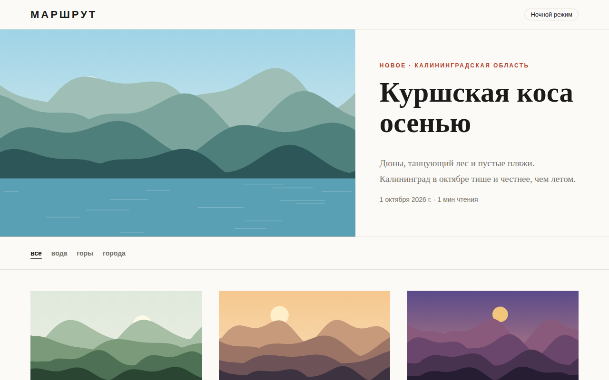

# Маршрут: тревел-блог

Многостраничный блог о путешествиях по России в журнальной вёрстке. Обложки статей не картинки, а SVG-пейзажи, которые скрипт генерирует по зерну и палитре.



## Возможности

**Главная**
- Самая свежая статья выводится крупной обложкой с лидом, датой и временем чтения
- Рубрики («вода», «горы», «города») собираются из статей автоматически
- Сетка карточек остальных статей, отсортированных по дате

**Статья**
- Полоса прогресса чтения вверху экрана
- Оглавление из заголовков статьи с подсветкой текущего раздела при прокрутке
- Время чтения из расчёта 170 слов в минуту
- Ссылки на соседние статьи внизу
- Страница «Статья не найдена» для неверной ссылки

**Общее**
- Ночной режим, выбор запоминается между страницами
- Пять статей с текстами, написанными для проекта

## Стек

HTML5, CSS3 (Grid, custom properties), JavaScript без библиотек, SVG, `localStorage`, шрифты PT Serif и Manrope из Google Fonts.

## Как запустить

Сборка не нужна: откройте `index.html` в браузере.

Или через локальный сервер:

```bash
python -m http.server 8000
# затем http://localhost:8000
```

## Настройка

- Статьи: массив `POSTS` в `js/posts.js` (slug, заголовок, рубрика, дата, место, палитра, зерно, флаг воды, лид, HTML текста). Заголовки `<h2>` в тексте становятся пунктами оглавления
- Палитры обложек: объект `PALETTES` там же (небо, солнце, четыре слоя гор, вода)

## Структура проекта

```
index.html          # главная: обложка, рубрики, сетка
article.html        # статья (?p=slug)
css/style.css       # стили, тёмная тема, адаптив
js/landscape.js     # генератор SVG-пейзажей
js/posts.js         # статьи, палитры, время чтения, формат даты
```

## Как это устроено

- `landscape()` рисует небо градиентом, солнце и четыре слоя хребтов: высота каждого слоя складывается из двух синусоид со случайными частотой и фазой
- Случайность идёт от линейного конгруэнтного генератора с зерном статьи, поэтому одна и та же статья всегда получает один и тот же пейзаж
- Если у статьи включена вода, хребты обрезаются по линии горизонта, а ниже рисуется гладь с бликами
- Тема ставится атрибутом `data-theme` на `<html>` в `<head>` до отрисовки страницы, поэтому при переходах нет мигания светлой темы
- Подсветка оглавления проверяет положение заголовков в пассивном обработчике прокрутки
- `prefers-reduced-motion` отключает анимацию карточек, до 900 px оглавление скрывается, а сетка становится в две колонки, до 600 px в одну

## Идеи для развития

- Поиск по статьям и фильтр по региону
- RSS-лента
- Карта маршрута внутри статьи

## Лицензия

MIT © 2026 whysafe. Telegram: [@yawhysafe](https://t.me/yawhysafe) · Сайт: [whysafe.ru](https://whysafe.ru)
